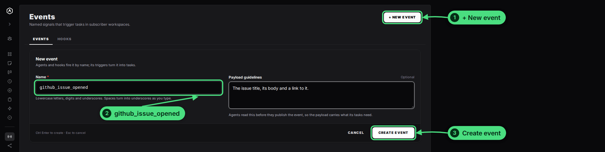
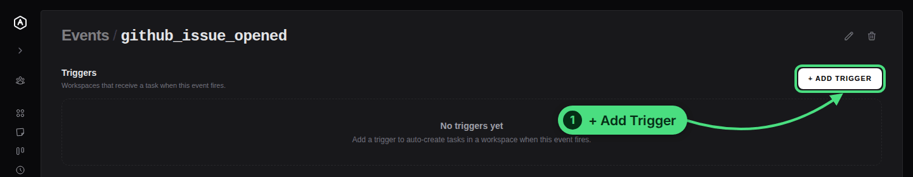
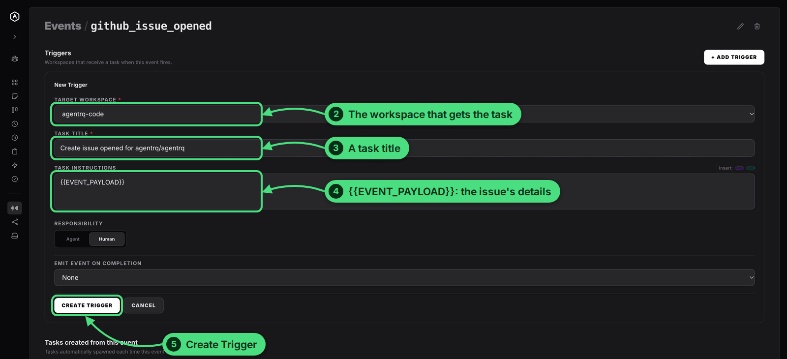
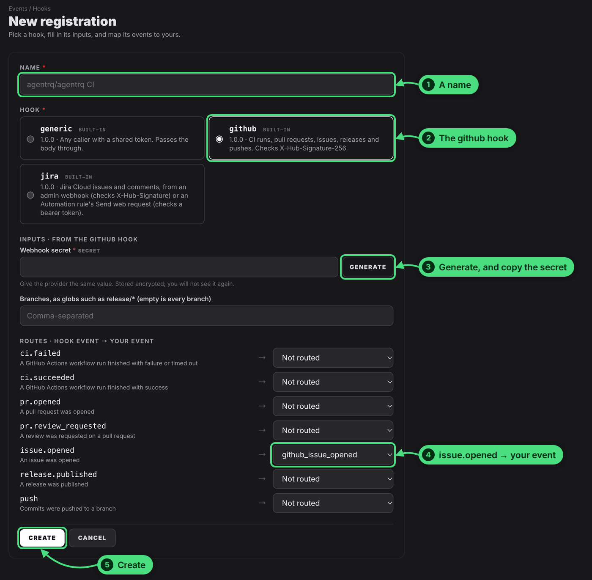
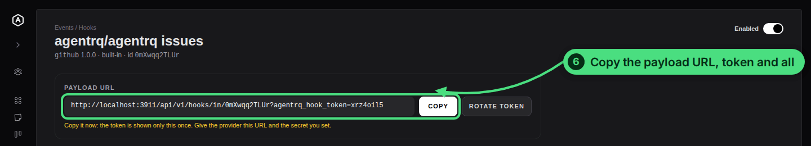
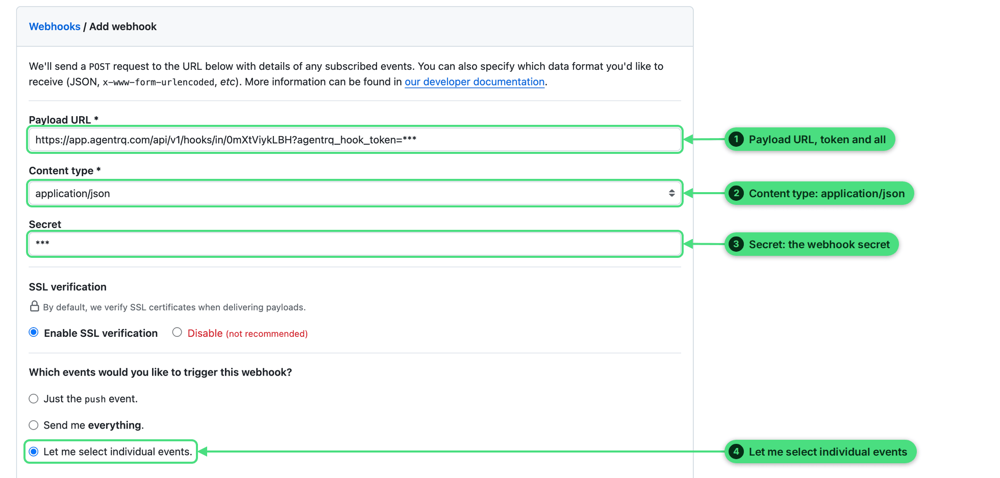
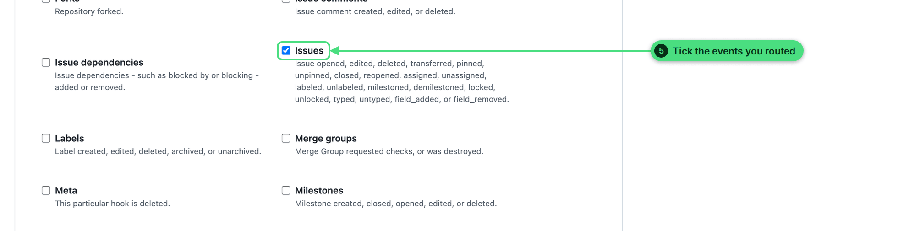
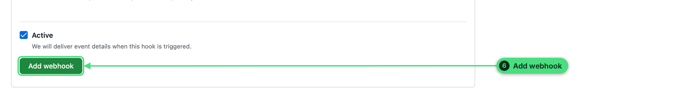

# Hooks

A hook turns a request from an outside service into one of your account's events, and so into a task. For example, when a GitHub Actions run fails, GitHub calls a hook URL and an agent gets a task to look at the failure.

- A **hook** is a small WebAssembly program that checks that a request is genuine and decides which events it fires. AgentRQ ships three built-in hooks, `github`, `jira` and `generic`, and you can write your own.
- A **registration** is one use of a hook in your account. It has a name, its own URL, the hook's inputs (such as the webhook secret), and **routes** that map each of the hook's events to one of your events.

An event fires the tasks its triggers describe, so set up the event and its trigger first: **Events → New event**, then add a trigger that creates a task in a workspace. A trigger's body can include `{{EVENT_PAYLOAD}}`, the request's details, and its title `{{EVENT_SUBJECT}}`, a one-line name the hook gives the event, such as `Jira issue ABC-1234: Login fails` or `GH I#12: Crash on start`. A title made only of `{{EVENT_SUBJECT}}` is the event's name when the event has no subject.

## Registering a hook

1. Open **Events → Hooks** and choose **New registration**.
2. Pick the hook and give the registration a name.
3. Fill in its inputs. Every hook has at least one secret, which the service you are connecting must also know. **Generate** makes a random one; **Copy** it now, because it is never shown again.
4. Route the hook's events to your events. An event left as **Not routed** is ignored.
5. Choose **Create registration**.

The page then shows the registration's **payload URL**. It ends with `?agentrq_hook_token=…`, and this is the only time the full URL is shown: copy it into the service now. If you lose it, **Rotate** gives the registration a new token. The old URL stops working at once.

A route to an event whose trigger has **YOLO mode** on, which runs every command without asking, is marked with a warning. Anybody who can send the hook a genuine request can start a task that runs any command, so route only events you would let that service start.

## The built-in hooks

### `github`

This example gives an agent a task whenever an issue is opened in a repository.

**1. Create the event.** Open **Events**:



1. **+ New Event**.
2. Name it `github_issue_opened`.
3. **Create event**.

**2. Add a trigger to it.** On the event's page:



1. **+ Add trigger**.



2. The workspace that gets the task.
3. A task title. **+ Event subject** puts `{{EVENT_SUBJECT}}` in it, which names each task after its issue, as `GH I#12: Crash on start`.
4. **+ Event payload** puts `{{EVENT_PAYLOAD}}` in the instructions, which brings in the issue's details.
5. **Create trigger**.

**3. Register the hook.** In **Events → Hooks**, choose **New registration**:



1. A name.
2. The **github** hook.
3. **Generate** a webhook secret.
4. **Copy** the secret: GitHub needs it, and it is never shown again.
5. Route `issue.opened` to `github_issue_opened`. Leave the others **Not routed**.
6. **Create registration**.



7. **Copy URL**: the payload URL, which ends in `?agentrq_hook_token=…`. Copy all of it, token included: it is shown only once.

**4. Add the webhook in GitHub.** In the repository, open **Settings → Webhooks → Add webhook**:



1. **Payload URL**: the payload URL you copied, with its `agentrq_hook_token`.
2. **Content type**: `application/json`. GitHub's default, `application/x-www-form-urlencoded`, is rejected.
3. **Secret**: the webhook secret from step 3. It is not the hook token.
4. **Let me select individual events**.



5. Tick the GitHub event for each route: **Issues** here. The others are **Workflow runs** (`ci.failed`, `ci.succeeded`), **Pull requests** (`pr.opened`, `pr.review_requested`), **Releases** (`release.published`) and **Pushes** (`push`).



6. **Add webhook**.

Open an issue to try it, and look in the registration's **Deliveries** if no task appears. **Branches** limits CI runs, pull requests and pushes to branches matching one of its globs, such as `main` or `release/*`; left empty, every branch counts.

### `jira`

For Jira Cloud: a **Send to AgentRQ** action on an issue (a Jira Automation rule's **Send web request**, with the secret in `Authorization: Bearer`) fires `jira.issue.sent`. A Jira admin webhook, signed in `X-Hub-Signature`, fires `jira.issue.created`, `jira.issue.updated` and `jira.comment.created`. The required **Assignees** and **Actors**, Jira account ids, limit it to issues assigned to those people, sent or changed by them; **Project keys** and **Labels** narrow it further. Each payload has the issue's key, summary, link, details and description as plain text.

[JIRA.md](JIRA.md) walks through every step of setting it up, in AgentRQ and in Jira.

### `generic`

For anything that can send an HTTP request with a header, such as a step in a CI pipeline or a cron job. It checks a shared **Token** and passes the request body through as the event's payload:

```bash
curl -X POST "$HOOK_URL" \
  -H "Authorization: Bearer $HOOK_SECRET" \
  -H 'Content-Type: application/json' \
  -H "Idempotency-Key: $CI_RUN_ID" \
  -d '{"job": "nightly-backup", "status": "failed"}'
```

`$HOOK_URL` is the payload URL, token included, and `$HOOK_SECRET` is the registration's **Token** input. **Header** names another header to carry the secret instead of `Authorization`. A request with the same `Idempotency-Key` (or `X-Request-Id`) as one already received is recorded as a duplicate and fires nothing, so a retry never makes a second task.

## What happens to a request

The server answers `202 Accepted` as soon as a request with a valid URL arrives, before the hook has looked at it. So a wrong secret or signature does not show up in the sender's logs. Look in the registration's **Deliveries** instead:

| Status | Meaning |
|---|---|
| `queued`, `processing` | Waiting for, or in, the hook. |
| `published` | Accepted, and its events fired. |
| `routed` | Accepted, and its events are about to fire. |
| `ignored` | Genuine, but nothing to do: none of its events is routed, or the hook said so, such as a run on a branch outside **Branches**. |
| `rejected` | The hook refused it, usually a wrong secret or signature. The reason is shown. |
| `duplicate` | The sender delivered the same request again. |
| `failed` | The hook crashed or ran out of time on six tries, over about two and a half hours. **Replay** runs it again. |

A URL with no token, a wrong token, or a deleted or disabled registration answers `404`, and the request is not saved. Requests are kept for 7 days by default.

## Making the URL reachable

The payload URL is built from the server's `AGENTRQ_BASE_URL`, so that must be the address the outside service can reach, not `localhost`.

- **Behind a reverse proxy**, it must pass `POST /api/v1/hooks/in/` through. The proxy setup in [SETUP_PRODUCTION.md](SETUP_PRODUCTION.md) does.
- **On a laptop or a private network**, put a tunnel such as `cloudflared tunnel --url http://localhost:3000` or `ngrok http 3000` in front of the server, and set `AGENTRQ_BASE_URL` to the tunnel's address.

The page always shows the URL at the current `AGENTRQ_BASE_URL`. When that address changes, the service still has the old one: change the address in the URL it holds (the token stays the same), or **Rotate** and give it the new full URL.

## Writing your own hook

When the server allows it (`AGENTRQ_HOOKS_ALLOW_USER_HOOKS=true`), **Events → Hooks → Your hooks** uploads your own hooks. Otherwise, ask the server's operator to add yours as a built-in hook.

A hook is a WASI preview1 program, written in any language that compiles to `wasip1`. It runs in a sandbox, a fresh one for every request: no files, no network, no environment, 32 MiB of memory and 250 ms. It is called two ways:

- **`manifest`**: it prints its name, version, inputs and events as JSON. It must declare at least one input that is both `secret` and `required`, and check it, because the URL's id alone can be guessed.
- **`handle`**: it reads `{registrationId, request, inputs, now}` on stdin and prints `{accept, reason, events}`. Each event has a `name` the manifest declares, and optionally a `dedupKey`, a `subject` (one line of at most 76 characters that a trigger's title takes through `{{EVENT_SUBJECT}}`; `sdk.Subject` makes one), a `payload` (a string or any JSON value) and a `faq`.

In Go, the SDK in [`wasm-hooks/sdk`](../wasm-hooks/sdk) does the plumbing:

```go
package main

import "github.com/agentrq/agentrq/wasm-hooks/sdk"

var manifest = sdk.Manifest{
	Name:    "deploys",
	Version: "1.0.0",
	Inputs:  []sdk.Input{{Name: "token", Label: "Token", Type: "string", Secret: true, Required: true}},
	Events:  []sdk.Event{{Name: "deploy.failed", Description: "A deploy failed"}},
}

func main() {
	sdk.Main(manifest, func(in sdk.In) sdk.Result {
		if !sdk.Equal(in.String("token"), in.Request.Header("X-Token")) {
			return sdk.Reject("wrong token")
		}
		return sdk.Accept(sdk.Out{Name: "deploy.failed", Payload: string(in.Request.Body)})
	})
}
```

```bash
GOOS=wasip1 GOARCH=wasm go build -o deploys.wasm .
```

- Compare secrets with `sdk.Equal`, which takes the same time whatever the input.
- Return `sdk.Reject` for a request that is not genuine, and `sdk.Accept` with no events for a genuine one with nothing to do.
- Inputs are `string`, `number`, `boolean` or `array` (with `Items` naming the element type). `Label` names one in the registration form, and `Placeholder` is an example value the form shows in the empty field, such as `main, release/*`.
- [`wasm-hooks/generic`](../wasm-hooks/generic/main.go), [`wasm-hooks/github`](../wasm-hooks/github/main.go) and [`wasm-hooks/jira`](../wasm-hooks/jira/main.go) are complete examples, with tests that run the built module.

Uploading a new version of a hook keeps its registrations, unless it would break one: an event someone routes is gone, an input becomes required, or an input changes type or stops being secret. Such an upgrade is refused. An input the new version drops is no longer given to it, and is cleared the next time the registration is saved.
